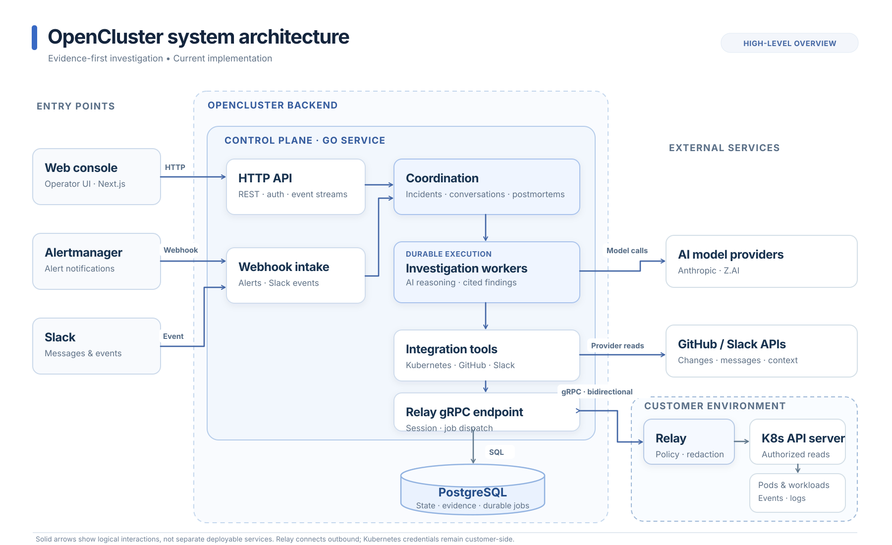

<p align="center">
  <picture>
    <source media="(prefers-color-scheme: dark)" srcset="./docs/logo/dark.svg">
    <source media="(prefers-color-scheme: light)" srcset="./docs/logo/light.svg">
    
  </picture>
</p>

<p align="center">
  <a href="https://docs.open-cluster.io/"></a>
  <a href="./LICENSE"></a>
</p>

<p align="center">
  <a href="https://docs.open-cluster.io/getting-started/quickstart">Quickstart</a> ·
  <a href="https://docs.open-cluster.io/api-reference/overview">API</a> ·
  <a href="https://docs.open-cluster.io/security/overview">Security</a> ·
  <a href="https://docs.open-cluster.io/developers/contributing">Contributing</a> ·
  <a href="https://discord.com/invite/8HrEBhUagE">Discord</a>
</p>

OpenCluster is an open-source AI SRE for production incident investigation.

It connects alerts with context from Kubernetes, GitHub, Slack, and other operational
systems to determine impact, investigate likely causes, and recommend what to do next.

Every material Finding is backed by the Tool Runs that support it, so operators can inspect
how a conclusion was reached instead of treating the AI response as a black box.
Uncertainty, missing telemetry, and unresolved assumptions remain explicit.

> OpenCluster is pre-release software. APIs and storage may change before the first stable release.

## How it works

1. An alert opens or updates an **Incident**, or an operator starts a **Conversation**.
2. OpenCluster opens a bounded **Investigation**.
3. The investigator selects authorized **Tools** from connected **Integrations**.
4. Tool Runs gather operational context and are recorded as evidence.
5. The Investigation produces impact, Findings, hypotheses, Action Proposals, and limitations.
6. Follow-up questions continue through the same Conversation without changing earlier Investigations.
7. Resolved Incidents can produce reviewed **Postmortems**.

An Investigation is immutable once completed. Follow-ups create new Investigations while
retaining bounded Conversation context and cited Findings established before the new
Investigation opened. Earlier reply details and older Messages are loaded on demand.

## Integrations

OpenCluster currently supports:

- **Kubernetes** — workload state, events, and logs through the OpenCluster Relay
- **GitHub** — repository and change context
- **Slack** — operational context and threaded conversations
- **Prometheus Alertmanager** — alert and Incident intake

Integrations expose only the capabilities that were successfully verified for that connection.

See the [integration documentation](https://docs.open-cluster.io/integrations).

## Capabilities

OpenCluster currently ships observation and read capabilities.

The capability model is not permanently limited to reads. State-changing capabilities must
add explicit authorization, human approval, idempotency, auditability, and verification
before they are enabled.

Today, OpenCluster recommends actions but does not execute production changes.

## Architecture



OpenCluster's Go control plane accepts operator requests and authenticated webhooks,
coordinates Incidents and Conversations, and runs evidence-backed Investigations.
Integration tools read GitHub and Slack directly or dispatch bounded Kubernetes
capabilities through the customer-side Relay.

**PostgreSQL is the durable source of truth** for product state, evidence, and
background work, including Relay jobs. The Relay establishes an **outbound,
bidirectional gRPC session** and keeps Kubernetes credentials and local data
controls inside the customer environment.

The diagram is a logical system overview, not a microservice or deployment topology.
See [ARCHITECTURE.md](./ARCHITECTURE.md) for workflow details and trust boundaries.

## Security

- Tenant-owned data is explicitly scoped to an Organization.
- Connected content and Conversation Messages are treated as untrusted data.
- Tools are available only through verified Integration capabilities.
- Credentials are sealed or digested and are not exposed through product APIs.
- Material Findings cite supporting Tool Runs.
- Current Action Proposals do not execute production changes.

See [SECURITY.md](./SECURITY.md) and the
[security documentation](https://docs.open-cluster.io/security/overview).

## Quick start

The fastest way to run OpenCluster locally is with Docker Compose:

```bash
docker compose -f deploy/compose/compose.yaml up --build
```

A local deployment requires PostgreSQL, an administrator bootstrap token, an encryption
key, and a supported model provider.

Follow the [Quickstart](https://docs.open-cluster.io/getting-started/quickstart) for full setup.

## Development

```bash
make tools
make test-short
make verify
```

See [CONTRIBUTING.md](./CONTRIBUTING.md) before submitting changes.

## Documentation

- [Product documentation](https://docs.open-cluster.io/)
- [Architecture](./ARCHITECTURE.md)
- [Domain glossary](./CONTEXT.md)
- [Roadmap](./ROADMAP.md)

## Contributing

Start with [CONTRIBUTING.md](./CONTRIBUTING.md). The project’s support, governance, maintainers, and roadmap are
documented in [SUPPORT.md](./SUPPORT.md),
[GOVERNANCE.md](./GOVERNANCE.md), [MAINTAINERS.md](./MAINTAINERS.md), and
[ROADMAP.md](./ROADMAP.md).
